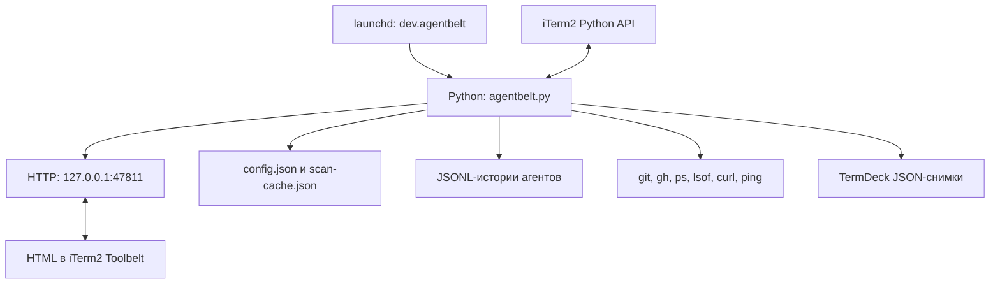

# Архитектура и разработка agentbelt

Описание относится к macOS-ветке `main` и включает первый этап экрана «Подключения». Исходная база изучения — коммит `c859464`. [Руководство пользователя](../README.md) и [справочник настроек](configuration.ru.md).

## Устройство проекта

Приложение — один Python-процесс, четыре HTML-страницы со встроенными CSS/JavaScript и скрипты установки для командной оболочки. Сборки клиентской части, npm-пакета, БД и собственного облачного сервера нет. Единственная прямая сторонняя библиотека Python для работы приложения — `iterm2`; её транзитивные зависимости устанавливает pip.

| Файл | Назначение |
|---|---|
| [`agentbelt.py`](../agentbelt.py) | Конфигурация, iTerm API, Git/gh, сканеры сессий, сеть, снимки, HTTP-сервер |
| [`pages/git.html`](../pages/git.html) | Git/PR-панель и просмотр diff |
| [`pages/agent.html`](../pages/agent.html) | Лента Claude и сетевой блок |
| [`pages/sessions.html`](../pages/sessions.html) | Проекты, истории, работающие агенты, снимки |
| [`pages/settings.html`](../pages/settings.html) | Формы настроек и предпросмотр запуска |
| [`pages/connections.html`](../pages/connections.html) | Выбор маршрута, добавление и проверки Claude/Codex |
| [`resources/feather/LICENSE`](../resources/feather/LICENSE) | MIT-лицензия локальных иконок Feather 4.29.2 |
| [`config.example.json`](../config.example.json) | Шаблон первой установки с демонстрационной сетью |
| [`install.sh`](../install.sh), [`uninstall.sh`](../uninstall.sh) | venv, конфигурация и LaunchAgent |
| [`resources/omp-new-session.yml`](../resources/omp-new-session.yml) | Разовая настройка для новой omp-сессии |
| [`tests/conftest.py`](../tests/conftest.py) | Заглушка iterm2 и временные каталоги для тестов |
| [`tests/test_toolbelt.py`](../tests/test_toolbelt.py) | Логика панелей, сканеры, команды, конфигурация, HTTP и JS-синтаксис |
| [`tests/test_connection.py`](../tests/test_connection.py) | Жизненный цикл при отключении iTerm2 и очистка фоновых задач |
| [`.github/workflows/tests.yml`](../.github/workflows/tests.yml) | Проверки на push и pull request |



## Жизненный цикл

Вход — `iterm2.run_until_complete(main, retry=True)`. `main()` поднимает `asyncio.start_server` на локальном интерфейсе и одновременно ожидает работу `iterm_session()` и закрытие websocket iTerm2.

`iterm_session()` регистрирует инструменты через `iterm2.tool.async_register_web_view_tool`, получает текущую область и подписывается на `FocusMonitor`. Идентификаторы `dev.iterm-toolbelt.*` оставлены от прежнего имени проекта, чтобы сохранить выбор вкладок в iTerm2.

Глобальный `STATE` хранит одну активную область: ID, имя, tty, cwd и метаданные Claude. Все страницы читают этот общий контекст. При изменении фокуса он обновляется сразу; каждые пять секунд дополнительно проверяются изменения каталога и процесса. Cwd берётся из iTerm-переменной `path`, затем через `lsof` для jobPid/pid.

При отключении API сервис отменяет задачи мониторинга, периодического опроса и автосохранения, очищает соединение и закрывает HTTP-сервер. Процесс завершается; `launchd` запускает новый. `retry=True` покрывает установление соединения, а отдельное ожидание `websocket.wait_closed()` — разрыв уже установленного соединения. Настройки вкладок могут инициировать выход через `os._exit(0)` после отправки HTTP-ответа.

## Источники данных

| Функция | Источник и особенности |
|---|---|
| `git_state()` | Корень через git rev-parse, status/diff/log, origin/main, отслеживаемая ветка; PR и CI через gh |
| `session_agent()` | PID на tty и `~/.claude/sessions/<pid>.json`; используется для ленты и снимков |
| `read_transcript()` | Claude JSONL: инкрементальное чтение завершённых строк, связывание tool_use/tool_result и маскирование |
| `_scan_all()` | Истории всех четырёх CLI, сортировка по mtime, дисковый кэш |
| `_active_agents()` | ps, Claude PID-файлы и lsof; Codex исключает app-server, pi определяется по процессу, omp не обнаруживается |
| `open_agent()` | Формирует команду, создаёт окно/вкладку, ждёт командную оболочку, отправляет cd и команду агента |
| `_net_probe()` | curl к API, ping и TCP-соединение с серверами с этого Mac |
| `_kn_state()` | Состояние Keenetic через RCI, в отдельном потоке |
| `capture_windows()` / `snap_restore()` | Вкладки и области через iTerm API, файловый формат TermDeck |

Пути сканирования:

```text
~/.claude/projects/*/*.jsonl
~/.codex/sessions/*/*/*/*.jsonl
~/.pi/agent/sessions/*/*.jsonl
~/.omp/agent/sessions/*/*.jsonl
```

Сканер читает начало файла с лимитом 512 KiB и лимитом строк. Codex использует **первую** запись `session_meta`, чтобы последующие унаследованные метаданные не подменили идентичность пользовательского форка. Сессии с `source.subagent` скрываются; служебные инструкции пропускаются при выборе заголовка. Для pi имя дополнительно ищется по всей истории при первом обращении, далее читаются добавленные байты. omp допускает запись title перед session.

Дисковый `scan-cache.json` содержит версию формата и результаты по файлам. При несовпадении `SCAN_VERSION` старые данные не используются. Сканирование удаляет записи исчезнувших файлов. Кэш включает пути и заголовки пользовательских запросов; это приватные локальные данные.

Защита возобновления pi объединяет проверку процессов в том же каталоге и временную резервацию по device/inode каталога. Базовый срок резервации — 30 секунд. Она предотвращает параллельные запросы продолжения, пока новый процесс ещё не появился; точного текущего ID pi сервис не получает.

## Обновление и кэши

Страницы периодически запрашивают данные через fetch. Поле `v` содержит идентификатор запуска `BOOT`, а не семантическую версию; при смене `v` страницы Git, действий агента и сессий перезагружаются.

| Данные | Интервал/TTL |
|---|---|
| Запрос страницы Git и ленты Claude | 1 с |
| Запрос сессий | 2 с |
| Запрос сети и снимков в UI | 5 с |
| Обновление активной области | 5 с, плюс события фокуса |
| Локальные Git-данные | 2,5 с |
| PR ветки / собственные PR | 60 / 120 с |
| Проверки репозитория / рабочие деревья | 45 / 30 с |
| Истории / работающие агенты | 20 / 4 с |
| Прокси и серверы / Keenetic | 60 / 15 с |
| git fetch origin | Не чаще раза в 300 с на репозиторий |

`cached()` ожидает результат, `cached_bg()` возвращает прежние данные и обновляет их в фоне. При первом запросе фонового источника результат может быть `null`; это не обязательно ошибка. TTL сам по себе не создаёт таймер: работа начинается при обращении к соответствующему источнику.

## Локальные HTTP-маршруты

Это внутренний интерфейс панелей, без отдельно заявленной совместимости версий. `/` показывает Git, `/agent` — ленту, `/sessions` — истории, `/settings` — настройки.

| Метод | Маршрут | Результат/действие |
|---|---|---|
| GET | `/state` | Git/PR-состояние; может инициировать fetch origin и проверки репозитория |
| GET | `/diff?f=<path>` | Текст diff выбранного файла |
| GET | `/agent/state` | Лента Claude |
| GET | `/agent/item?i=<index>` | Подробности действия |
| GET | `/sessions/state` | Истории и работающие агенты |
| GET | `/snaps/state` | Список снимков и автосохранение |
| GET | `/net/state` | Сеть; может инициировать внешние проверки |
| GET | `/settings/state` | Конфигурация для интерфейса с маскированием URL прокси и без пароля Keenetic |
| GET | `/connections/state` | Назначения Claude/Codex, адреса без учётных данных и результаты проверок; не возвращает prefix/flags |
| POST | `/connections/check` | JSON: `name` существующего маршрута или `proxy` для предварительной проверки; не сохраняет конфигурацию |
| POST | `/connections/save` | JSON: новый `proxy` и/или `defaults` для Claude/Codex; атомарная запись после валидации |
| POST | `/sessions/open` | Новая/возобновлённая сессия; параметры tool, id, dir, skip, where, proxy |
| POST | `/sessions/focus?tty=<tty>` | Переключение на область iTerm2 |
| POST | `/snaps/save?name=<name>&scope=window` | Снимок текущего окна; scope=all — всех окон |
| POST | `/snaps/restore?name=<name>&skip=0` | Восстановление в новом окне |
| POST | `/settings/save` | JSON-тело конфигурации |
| POST | `/net/copy?name=<proxy>` | Полная export/unset-команда в буфер обмена |
| POST | `/open-url?url=<url>` | HTTP(S)-ссылка в браузере по умолчанию |

Ошибки `/connections/check` и `/connections/save` возвращают HTTP 400 и JSON `{ "ok": false, "error": "…" }`. Назначения проверяются по списку маршрутов после добавления, поэтому новый прокси и его назначения можно сохранить атомарно. Неизвестное назначение отклоняет весь запрос. Проверка перед добавлением сохраняет результат только в памяти; кэш связан с именем и полным URL, чтобы смена учётных данных не показывала старый результат. Результаты не содержат URL с секретами. Иконки обслуживаются по точному списку путей `/assets/feather/*.svg`.

Все POST-действия требуют `X-Toolbelt: 1`, иначе возвращается 403. Большинство логических ошибок возвращаются текстом с HTTP 200: клиент проверяет тело (`ok`, `copied`, `restart` или описание ошибки). У `/open-url` дополнительно есть HTTP 400/502. Успешная отправка команды в командную оболочку не является проверкой успешного запуска или входа CLI.

Ответы имеют `Cache-Control: no-store`. Сервер не реализует отдельную авторизацию читателей. Это локальный сервис для доверенной локальной среды; подробности секретов и границы защиты описаны в [настройках](configuration.ru.md#обращение-с-секретами).

## Проверки разработчика

В установленной копии уже есть пригодный Python/pytest. Запуск:

```bash
cd /Users/mizenko/Vibecode/agentbelt
~/.config/agentbelt/venv/bin/python -m py_compile agentbelt.py
~/.config/agentbelt/venv/bin/python -m pytest -q tests
bash -n install.sh uninstall.sh
```

Для разработки без установки LaunchAgent создайте отдельное окружение с Python 3.10+; пример при наличии Homebrew Python 3.12:

```bash
cd /Users/mizenko/Vibecode/agentbelt
/opt/homebrew/bin/python3.12 -m venv .venv
.venv/bin/python -m pip install pytest
.venv/bin/python -m pytest -q tests
```

Тесты заменяют `iterm2` модулем-заглушкой и перенаправляют конфигурацию, истории и снимки во временные каталоги. Для самих тестов установка `iterm2` не нужна. Проверка JavaScript использует `node --check` и пропускается, если Node.js отсутствует. Один тест зависит от macOS `lsof`. CI запускается на Ubuntu с Python 3.12 и Node.js 20.

Для ручного запуска реального сервиса дополнительно установите `iterm2` в выбранное окружение, включите Python API и предварительно остановите LaunchAgent во избежание конфликта порта. Обычный путь эксплуатации — `./install.sh`, обеспечивающий автоматическое восстановление соединения.

Тесты проверяют парсинг и маскирование, идентичность Codex-форков, кэши, pi/omp, защиту продолжения pi, сохранение настроек, сетевую логику, снимки, HTTP-ограничения и закрытие соединения. Они не доказывают реальный пользовательский сценарий iTerm2 или внешний вход CLI. Для изменений интеграции дополнительно проверяйте переключение областей, запуск/продолжение, снимки и восстановление после перезапуска iTerm2 на настоящем приложении.

## Ориентиры для изменений

- Новый агент требует сканера, команды запуска, списка агентов в HTML и тестов; наличие ветки в `agent_command()` само по себе не даёт полноценной поддержки UI. Дополнительные qwen/kilo/opencode/cursor здесь используются лишь как команды возобновления для совместимых снимков.
- Если изменение сканера должно перепарсить неизменившиеся файлы, увеличьте `SCAN_VERSION`.
- При добавлении действия синхронно обновляйте POST/header-ограничение в `handle()` и клиентский fetch.
- Если добавляете настройку, проверьте DEFAULTS, settings_state/settings_save, форму и config.example.json; маскирование секретов должно учитывать путь туда и обратно.
- Для релиза ориентируйтесь на коммит: `VERSION = "0.1.0"` — константа, а не автоматическая версия Git.
